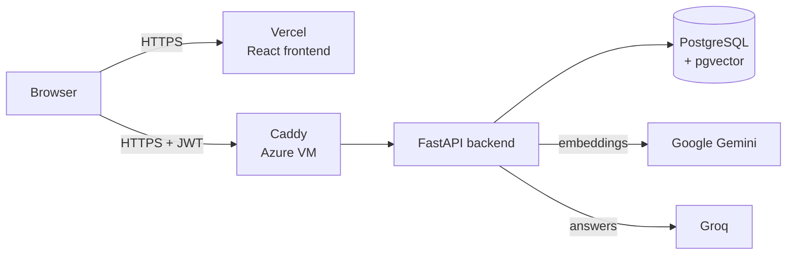

# StudyMind

An AI study assistant: students upload their lecture PDFs and ask questions.
StudyMind answers **only from their own documents** and shows the
**pages it used**, so every answer can be checked with one click.

**Live demo:** https://studymind-neon.vercel.app
(create an account; limits: 20 documents per user, 30 questions per hour)

**API docs:** https://studymind-oussama.denmarkeast.cloudapp.azure.com/docs

## Features

- **Courses and PDF upload:** each course has its own documents. PDFs are
  read, split into chunks and embedded in the background; a notification
  tells you when a document is ready.
- **Answers with sources (RAG):** a question is embedded, the closest
  chunks are found with pgvector, and the model answers only from them,
  in the language of the question. If the documents do not contain the
  answer, StudyMind says so instead of guessing.
- **Check every source:** clicking a source opens the PDF next to the
  answer, at the cited page.
- **Accounts:** register and log in; every course and file is private to
  its owner.
- **Limits** that protect the free AI quotas.
- **Accessible and responsive:** works on phones, with the keyboard and
  with screen readers; animations turn off when the system asks for
  reduced motion.

## Architecture

- **Frontend:** React, TypeScript, Vite, Tailwind CSS, React Router
- **Backend:** Python, FastAPI, SQLAlchemy 2.0, Alembic
- **Database:** PostgreSQL 17 with pgvector
- **AI:** Gemini embeddings (768 dimensions) and Groq (`gpt-oss-120b`)
  for fast answers as structured JSON
  ([ADR 008](docs/adr/008-groq-for-answers.md))
- **Infrastructure:** Docker Compose, Caddy (automatic HTTPS), Azure VM,
  Vercel, GitHub Actions, GitHub Container Registry