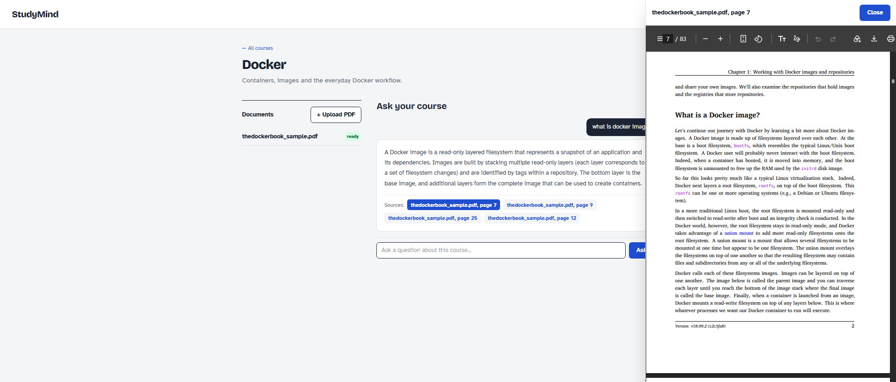
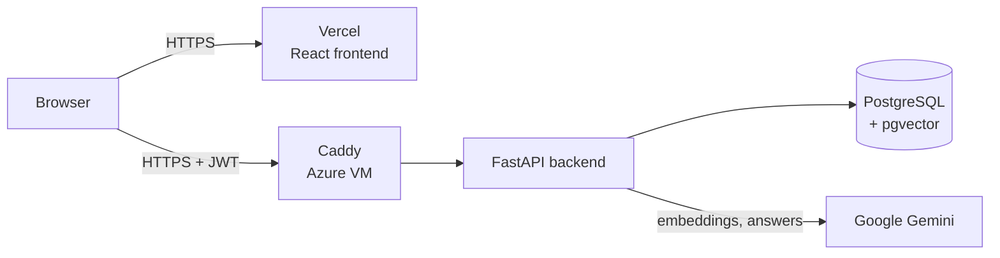

# StudyMind


An AI study assistant: students upload their lecture PDFs and ask questions.
StudyMind answers **only from their own documents** and shows the
**pages it used**, so every answer can be checked.

**Live demo:** https://studymind-neon.vercel.app
(create an account; limits: 20 documents per user, 30 questions per hour)



## Features

- **Courses and PDF upload:** each course has its own documents. PDFs are
  read, split into chunks and embedded in the background; the status
  (processing, ready, failed) updates live.
- **Answers with sources (RAG):** a question is embedded, the closest
  chunks are found with pgvector, and Gemini answers only from them.
  If the documents do not contain the answer, StudyMind says so instead
  of guessing.
- **Accounts:** register and log in; every course is private to its owner.
- **Limits** that protect the free AI quota.

## Architecture



- **Frontend:** React, TypeScript, Vite, Tailwind CSS, React Router
- **Backend:** Python, FastAPI, SQLAlchemy 2.0, Alembic
- **Database:** PostgreSQL 17 with pgvector
- **AI:** Gemini embeddings (768 dimensions) and Gemini Flash with
  structured output
- **Infrastructure:** Docker Compose, Caddy (automatic HTTPS), Azure VM,
  Vercel, GitHub Actions, GitHub Container Registry

## Engineering

- **Tests:** pytest with Testcontainers (a real PostgreSQL, no mocks for
  the database) and Vitest with React Testing Library.
- **CI/CD:** every pull request runs linting, formatting checks, tests and
  the build. Every merge to `main` builds the backend image, pushes it to
  GHCR and deploys it to the Azure VM over SSH. Vercel deploys the frontend
  and creates a preview for each pull request.
- **Security:** Argon2 password hashes, short-lived JWTs, the same error for
  a wrong email or password, 404 instead of 403 for other users' courses,
  rules against prompt injection, Markdown rendering without raw HTML.
- **Decisions are documented** as ADRs in [`docs/adr`](docs/adr), and the
  server setup as a runbook in [`docs/runbooks`](docs/runbooks).

## Run it locally

Requirements: Docker with Docker Compose, and a free
[Gemini API key](https://aistudio.google.com/apikey).

```bash
git clone https://github.com/oussama-abid/studymind.git
cd studymind
cp .env.example .env   # set your passwords, GEMINI_API_KEY and JWT_SECRET_KEY
docker compose up --build
```

Then open:
- App: http://localhost:5173
- API docs: http://localhost:8000/docs

To run the frontend or backend without Docker (with hot reload), see
[`frontend/README.md`](frontend/README.md) and
[`backend/README.md`](backend/README.md).

## Project structure

```
frontend/   React app
backend/    FastAPI app, migrations and tests
docs/       Product spec, ADRs and runbooks
```

## Roadmap

- Save the chat history per course
- Stream answers while they are generated
- Support scanned PDFs (OCR)